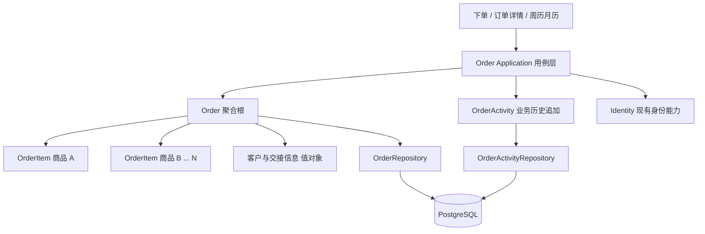
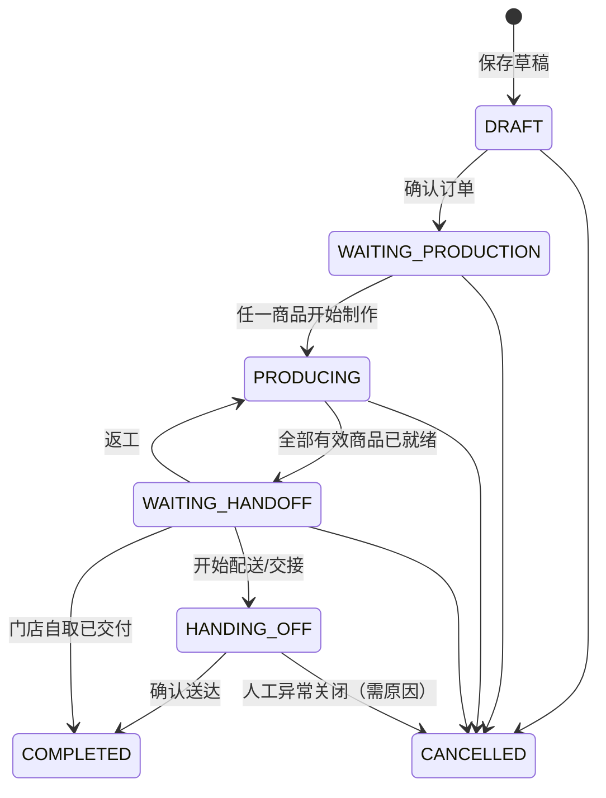
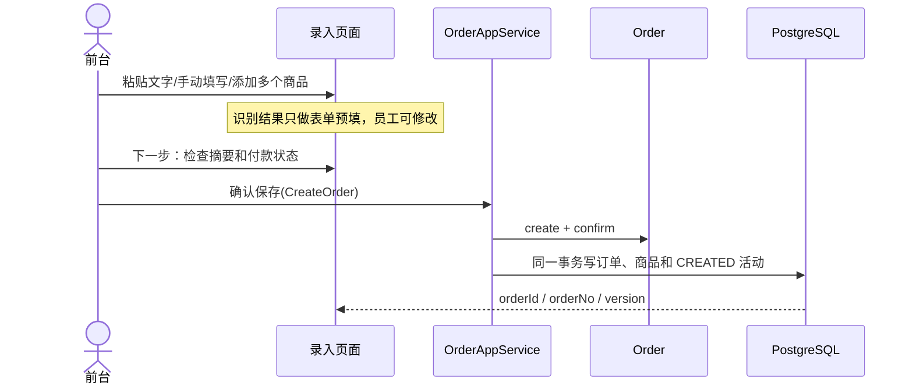

# WuhouCake 订单领域建模与下一阶段开发实施文档（v3.0）

> **状态：开发设计稿（可用于下一阶段编码）**\
> **原则：业务闭环优先、轻量 DDD、模块化单体、按需验证、允许渐进演进。**\
> **适用范围：** 基于 2026-10 上传的 PRD、六张 UI 初稿及仓库 `GorwayWong/WuhouCake` 的 `main` 分支文档与 POM。\
> **本阶段交付：** `WuhouCake-order` 领域模块；先实现「录入订单 → 确认 → 多商品制作 → 交接 → 完成 → 备注与变更记录」闭环。

## 0. 先读：本轮审计后的明确决策

| 议题 | 本轮决策 | 为什么 |
| --- | --- | --- |
| 工程架构 | 保留现有 COLA Light 模块化单体；**仅新增 `WuhouCake-order` 模块** | 已有 bootstrap / shared / identity / audit，不需要新的运行单元 |
| 订单与商品 | `Order` 聚合根 + 多个 `OrderItem` 子实体 | 订单包含多个商品，并保障统一交接的业务规则 |
| 订单状态与制作节点 | **分开建模**：订单主状态 + 每个商品制作状态/节点 | 不能把“已夹层、已抹面”和“待配送”混成一条枚举 |
| 制作、配送 | 首期不单独建 `ProductionTask`、`DeliveryTask` 聚合/模块 | 尚无明确独立分派、拆单、部分配送生命周期需求 |
| 商品属性 | `OrderItem` 固定公共字段 + `attributes JSONB` 快照 | 加尺寸、夹层、装饰、配件属性不需要反复改列 |
| 商品目录 | **首期不建** `ProductCatalog/ProductTemplate` | 实际 UI 可以直接填写商品；有重复模板诉求再加，订单快照不受影响 |
| 付款 | `PaymentStatus` 与 `OrderStatus` 独立 | 未付款不等于未制作；人工确认付款并非支付网关对账 |
| 员工协作 | 一张 `order_activity` 承载**备注与业务变更历史** | 页面既需要最近三条备注，也需要修改日志，避免两份相似记录系统 |
| 身份与审计 | 复用 `identity`；业务历史放 `order`，不复用安全审计作为订单事实源 | 现有 `audit` 面向系统操作审计，其写入并不保证与业务事务同步 |
| 事务与一致性 | 单库事务 + 订单乐观锁 `version`；备注独立追加 | 解决真实并发与业务追溯，不引入 MQ / Outbox / 事件溯源 |
| 测试与治理 | 仅围绕**关键业务不变量和数据库写入**做必要验证；复用现有检查 | 不堆叠探针、快照、门禁、测试矩阵，但不放弃基本正确性 |

**审计纠错：** 上一版同时要求单一 `Order` 维护状态，又让独立 `ProductionTask` 的领域事件异步更新订单，这在当前单库场景中平白引入双状态源、跨聚合一致性和重试问题。本版先以 `Order` 管控多商品制作和整体交接。**只有当制作任务确实能独立派工、部分交付或跨订单排产时，再提取任务聚合。**

---

## 1. 依据与现状：事实、推断和待确认项

### 1.1 已有依据（不是新需求）

- **PRD** 将系统定义为店内协作工作台，强调订单协作、状态推进、事件记录，不希望建设复杂 ERP；第一阶段包含登录、创建订单、列表、状态、评论和日志。
- **UI** 展示两步下单、草稿保存、订单/付款状态、一个订单内多个产品、产品规格、日期工作台、单个商品制作节点、订单详情备注与日志；日历卡片需要展示每个蛋糕的最近三条备注（备注人、时间、内容）。
- **仓库文档与 POM** 显示 Java 21 / Spring Boot 3.5.x / PostgreSQL / MyBatis-Plus / Flyway / Redis；已有 `WuhouCake-bootstrap`、`WuhouCake-shared`、`WuhouCake-identity`、`WuhouCake-audit` 和空白 `WuhouCake-sample`；**根 POM 尚未登记 `WuhouCake-order`**。
- **仓库架构规约**：领域模块包为 `api / adapter / application / domain / infrastructure`；domain 为无 Spring / ORM 依赖的纯 Java，application 控制事务，bootstrap 显式装配 Bean；Flyway 版本跨仓库唯一。
- **现有身份语义**：岗位枚举为 `MANAGER / FRONT_DESK / PASTRY_CHEF`，用户可以兼任岗位；与 PRD 中的 `BAKER / DELIVERY` 不完全一致，**首期不得另外造一个角色体系**。
- **本次范围不是已经执行过的代码审计**：基于上述文件与设计进行了架构审查；没有运行仓库构建或实测 HTTP，不能据此宣称现有实现通过或失败。

### 1.2 关键业务假设（先采用，不阻塞开发；产品确认后按局部规则修改）

1. **一个订单原则上作为一个交接单元**：订单中所有商品准备完毕，才可进入交接/配送；首期不支持部分交付。
2. **制作进度以商品为单位**：同订单多个蛋糕可处于不同节点；进度不会被一个订单状态覆盖。
3. **付款状态由员工手工维护**：不接第三方支付回调，`已付款` 不是银行资金已核对的证明。
4. **备注是沟通信息，不是已生效订单字段**：客户需求改变必须显式更新 `OrderItem.attributes`，并产生变更记录。
5. **时间含义**：`收货日期` 为客户期望日期；`计划交接时间` 用于日历排序和配送/自取；`计划出品时间` 是制作截止时间。截图中的“取货时间”究竟指门店自取还是配送员取件，需与业务方统一口径。
6. **时区**：示例按门店 `Asia/Shanghai`，持久化实际时间用 `TIMESTAMPTZ`。门店不在该时区时改配置，不在代码中写死。
7. **付款与制作默认不互相阻断**：已付订单可未制作，未付订单也可完成；如门店要求先付定金再制作，日后在订单领域新增一个前置规则。

> 上述 1、3、5、7 项属于产品待确认约束；不是 PRD 已明确承诺的事实。对它们的调整不需要先建设通用工作流框架。

---

## 2. 业务语言（统一 UI / 领域 / 数据库）

| 业务术语 | 建议代码名称 | 含义与边界 |
| --- | --- | --- |
| 订单 | `Order` | 顾客的一次订购与整体交接约定；聚合根 |
| 订单商品 | `OrderItem` | 一件具体商品及数量、规格快照、制作进度；聚合内实体 |
| 商品规格快照 | `ItemAttributes` | 这次订单确认的尺寸、口味、夹层、装饰、祝福语等；不是商品目录实时引用 |
| 订单生命周期 | `OrderStatus` | 草稿、待制作、制作中、待交接、交接中、完成、取消 |
| 商品制作状态 | `ItemProductionStatus` | 未开始、制作中、已就绪；不等于细分制作节点 |
| 制作节点 | `currentStageCode` | 已夹层、已抹面等进度标签；**不直接决定订单生命周期** |
| 交接方式 | `FulfillmentType` | 配送或门店自取；影响状态在 UI 的显示文案 |
| 付款状态 | `PaymentStatus` | 未付款 / 已付款；独立于 `OrderStatus` |
| 备注 | `OrderActivity(type=NOTE)` | 员工沟通记录，可关联具体商品 |
| 变更记录 | `OrderActivity(type=...)` | 商品、状态、付款等变化的业务轨迹 |
| 操作审计 | 现有 `audit` | 登录、员工管理等系统操作审计；不作为订单展示的数据源 |

**不要出现同义的多个状态字段**（例如 `orderStatus`、`workflowStatus`、`productionStatus` 全写在订单上且彼此独立变更）。

---

## 3. 限界上下文和聚合边界



### 3.1 只有一个新的领域模块

```text
WuhouCake-bootstrap     # 继续作为唯一启动与 Bean 装配入口
WuhouCake-shared        # 复用响应契约、通用错误等技术能力
WuhouCake-identity      # 已有员工账号、登录、岗位；不复制
WuhouCake-audit         # 保留系统安全审计职责
WuhouCake-order         # 本次新增，包含订单、订单商品、制作进度、交接、业务备注
WuhouCake-sample        # 现有模板；开发完成后无需删除
```

### 3.2 `Order` 聚合真正需要保证的规则

- 草稿可不完整；确认后的订单至少包含 1 个有效商品、客户电话、期望收货日期、计划交接时间。配送订单额外要求配送地址；自取不强制地址。
- 商品必须隶属于一个订单；修改商品通过 `Order` 的方法进入，不能绕过聚合根直接从外部改 `OrderItem`。
- 一张订单内**全部有效商品就绪**才能进入 `WAITING_HANDOFF`；新增、移除商品或返工都会重新计算交接资格。尤其是已就绪订单新增未制作商品时，必须退回 `PRODUCING`，不能继续显示待配送。
- 商品已开始制作或已就绪时，修改规格必须由操作者**显式确认返工并填写原因**，并重置该商品的当前制作节点；不得悄悄保留“已就绪”标记。交接开始后首期不允许改商品规格。
- 完成/取消后不能继续推进制作或配送；备注允许追加，便于售后沟通。付款可以在交接完成后由人工补录，仍要留下记录。
- 付款和生命周期各自独立；付款改变不自动修改制作状态。

### 3.3 不纳入 Order 聚合的东西

- 不装载订单所有备注、历史、图片原始二进制到聚合对象。
- 不装载员工账号、登录会话；仅保留 `createdById` 与业务历史中的员工显示名快照。
- 不把 `ProductionTask`、`DeliveryTask`、`PaymentTransaction` 当作默认必建实体。
- 不让领域对象发送 HTTP、访问 Redis、操作 Mapper 或发布 MQ 事件。

**轻量 DDD = 清晰业务不变量 + 正确事务边界**，不等于把所有名词都做成 Repository / Aggregate / DomainService。

---

## 4. 状态与工作流：避免将来每加节点就改订单状态机

### 4.1 订单主状态（稳定的生命周期）



**枚举建议：**

```java
public enum OrderStatus {
    DRAFT,
    WAITING_PRODUCTION,
    PRODUCING,
    WAITING_HANDOFF,
    HANDING_OFF,
    COMPLETED,
    CANCELLED
}

public enum PaymentStatus { UNPAID, PAID }
public enum FulfillmentType { DELIVERY, PICKUP }
public enum ItemProductionStatus { NOT_STARTED, IN_PROGRESS, READY }
```

| 订单主状态 | UI 展示 | 对应含义 |
| --- | --- | --- |
| `DRAFT` | 草稿 | 不进正式日历与待制作队列 |
| `WAITING_PRODUCTION` | 待制作 | 已确认，尚未开始制作任何商品 |
| `PRODUCING` | 制作中 | 部分/全部商品正在制作；可能有部分商品已就绪 |
| `WAITING_HANDOFF` | 待配送 / 待自取 | 全部商品已就绪，按交接方式选择文案 |
| `HANDING_OFF` | 配送中 / 交接中 | 已由人员执行交接；配送模式更常用 |
| `COMPLETED` | 已完成 | 已送达或已取走 |
| `CANCELLED` | 已取消 | 不再继续常规流转 |

**首期约束：** 交接异常取消需留下原因；已完成不得取消，实际退款与售后不在本阶段范围。取消已付款订单只记录人工待处理事项，**不得自动把付款状态改回未付款**。

### 4.2 每个商品独立维护制作进度

```text
订单 0000105：PRODUCING
  ├─ 小兔子蛋糕     IN_PROGRESS / currentStageCode=FILLING_DONE（已夹层）
  ├─ 纸杯蛋糕 × 6   READY       / currentStageCode=null
  └─ 甜甜圈 × 2     NOT_STARTED / currentStageCode=null

订单主状态仍为 PRODUCING；只有 3 项商品全部 READY 才转 WAITING_HANDOFF。
```

**制作状态与制作节点是两个维度：**

- `ItemProductionStatus` 只有三种稳定状态，决定是否“已就绪”。
- `currentStageCode` 只是制作过程中的具体里程碑，可为空；**标记已夹层/已抹面不等于制作完成**。
- 仅允许已开始制作的商品记录制作节点。默认节点可以在订单模块中维护一个小型只读字典：`FILLING_DONE → 已夹层`、`FROSTING_DONE → 已抹面`。新增“已包装”只需增补代码/名称及 UI 展示，不改订单表列。
- 不要求商品必须经历相同节点：纸杯蛋糕可以跳过“夹层”，其他商品也可自定义节点。**首期不设计可视化流程编辑器、状态机数据库或通用节点编排器。**
- 需求真的出现“不同蛋糕有严格不同且须冻结的节点顺序”时，再为订单商品增加 `stagePlanSnapshot`，避免历史订单被新配置追溯改变。当前没有该确定需求，不提前创建。

### 4.3 常见变更的处理

| 变更场景 | 本阶段设计如何应对 | 需要修改哪里 |
| --- | --- | --- |
| 一个订单从 1 个商品变成 3 个 | 原生 `items: List<OrderItem>` | 数据模型无变化；UI 增加切换/新增入口 |
| 新增甜甜圈、配件等产品类型 | `productType + attributes JSONB`；公共字段不变 | 输入表单与少量业务校验，无表结构改动 |
| 新增“裱花”“包装”制作节点 | `currentStageCode` 记录代码，操作历史记录过程 | 增补节点字典和 UI，不新增主状态 |
| 客户临时改芒果 | 修改对应 `OrderItem.attributes`，生成活动记录 | 更新一个商品，不改变其他商品数据 |
| 订单已就绪，客户要求返工 | 显式返工，商品改回制作中，订单回 `PRODUCING` | 一个领域操作与对应页面操作 |
| 以后需要拆包/部分配送 | **此时才**引入 `Fulfillment` / `DeliveryTask` 聚合 | 业务规则和持久化结构需要演进，不承诺零改动 |
| 以后增加“客户确认”这个必经节点 | 明确它影响的是订单确认还是某商品制作验收 | 在所属状态/约束处扩展，而非万能流程配置 |

**设计目标是“变化局部化”，不是保证所有新业务无需代码变更。**

---

## 5. 领域模型（面向真实业务行为，而非数据库 setter）

```text
Order                                    [Aggregate Root]
 ├─ id / orderNo / version
 ├─ status / paymentStatus
 ├─ CustomerContact                       [Value Object]
 │    ├─ customerName / phone / memberPhone / buyerName
 ├─ FulfillmentPlan                       [Value Object]
 │    ├─ type / address / requestedReceiveDate
 │    ├─ plannedHandoffAt / plannedFinishAt
 ├─ PaymentSummary                        [Value Object]
 │    ├─ totalAmountCents? / paidAmountCents? / paymentMethod?
 ├─ List<OrderItem>                        [Child Entities]
 │    ├─ itemId / name / productType / quantity
 │    ├─ unitPriceCents? / memberPriceCents?
 │    ├─ attributes                        [JSON snapshot, domain plain data]
 │    └─ productionStatus / currentStageCode
 └─ createdBy / createdAt / confirmedAt / updatedAt

OrderActivity                              [Append-only business record, OUTSIDE Order]
 ├─ orderId / optional itemId
 ├─ type / content / details
 ├─ actorId / actorDisplayNameSnapshot
 └─ createdAt
```

### 5.1 建议的核心行为

```java
// domain/model/aggregate/Order.java（行为示意，不是要求完整照抄）
public final class Order {
    public void confirm();
    public void reviseCustomer(CustomerContact contact);
    public void reviseFulfillment(FulfillmentPlan plan);
    public void addItem(OrderItem item);
    public void reviseItem(UUID itemId, ItemRevision revision, ReworkConfirmation rework);
    public void removeItem(UUID itemId);
    public void startItem(UUID itemId);
    public void recordItemStage(UUID itemId, String stageCode);
    public void markItemReady(UUID itemId);
    public void reopenItemForRework(UUID itemId);
    public void startHandoff();
    public void completeHandoff();
    public void markPaid(String method, Long paidAmountCents);
    public void markUnpaid(String reason);
    public void cancel(String reason);
}
```

`Order` 无需暴露无约束 `setStatus()`；但也不应堆满抽象策略类。普通字段检查可以在一个 `requireStatus(...)` 私有方法完成。领域对象不抛 Spring 异常；用明确的业务异常在 Web 层映射到稳定错误码。

**必要的不变量示例：**

```java
public void markItemReady(UUID itemId) {
    if (status != OrderStatus.PRODUCING) {
        throw new DomainException("ORDER_NOT_PRODUCING");
    }
    OrderItem item = requireActiveItem(itemId);
    item.markReady();
    if (activeItems().stream().allMatch(OrderItem::isReady)) {
        status = OrderStatus.WAITING_HANDOFF;
    }
}
```

> 只展示业务方法；对象构造、加载、持久化和异常实现按现有代码风格完成，不为每条规则引入独立 Handler/Factory/Policy 类。

### 5.2 商品快照示例

```json
{
  "name": "小兔子",
  "productType": "CAKE",
  "quantity": 1,
  "attributes": {
    "size": "8寸",
    "flavors": ["芒果", "脆啵啵", "奥利奥"],
    "filling": "芒果",
    "cakeBase": "红丝绒",
    "greeting": "3周岁生日快乐！",
    "otherRequirements": "少糖"
  }
}
```

`attributes` 是**本订单认可的商品要求快照**，不是商品模板 ID 的实时映射。新商品可以拥有不同的 attributes 键；`name/productType/quantity` 属于通用字段，便于列表、统计与商品切换。若以后出现商品目录，新增可选的 `templateId`，不能以模板当前配置覆盖既有订单快照。

### 5.3 金额与付款的实用约定

- 金额以**整数分**存储，Java 使用 `Long` / `long`（数据库 `BIGINT`），固定人民币；禁止 `double` 存储金额。
- 当前 UI 同时展示“价格、会员价”，**这两项可能是报价而非实收金额**；首期保留商品的 `unitPriceCents/memberPriceCents`，订单另有人工确认的 `totalAmountCents/paidAmountCents`。**不在未明确折扣、配送费和会员规则时自动计算实收。**
- `null` = 尚未填写；`0` = 已明确为零，不得混同。
- `PaymentStatus=PAID` 为人工操作事实；是否允许在金额未知时标为已付款，采用“允许但提示待补全”的首期约定，后续可调整为业务规则。
- 不实现分次支付、退款流水或微信支付接入；需要时再引入 `PaymentRecord`，不可把 `PAID/UNPAID` 强行扩展成财务总账。

---

## 6. 业务操作：每一步谁做、写什么、留什么记录

### 6.1 创建订单（对应两步录入 UI）



- **OCR/文本提取不参与领域确认**，结果始终可编辑，不要求识别全部正确才可录单。
- UI 的“下一步：确认订单”只是表单步骤，**不能将其误当作制作状态**。
- “保存草稿”写入 `DRAFT`，可容忍不完整表单；正式确认时再检查最低必填项。
- `orderNo` 由后端唯一生成，不相信客户端提交的订单号。

### 6.2 客户临时修改口味

1. 前台在商品 A 选择“修改要求”，将 `flavors`/`filling` 等真实字段改为客户最终确认的值。
2. `Order.reviseItem` 校验当前是否可修改：商品尚未开始制作时直接修改；商品已在制作/已就绪时，UI 必须先确认“需要返工”并提交原因，领域方法才允许本次修改，同时重置该商品的制作节点、撤销其就绪标记。如果订单原为 `WAITING_HANDOFF`，须回到 `PRODUCING`。交接中/已完成/已取消的订单首期拒绝直接修改制作要求。
3. 同一数据库事务写 `order_item` 和 `order_activity(type=ITEM_CHANGED)`，活动中记录**字段名、旧值、新值和操作人**；前台可以额外追加 `NOTE` 沟通原委。
4. 日历和订单详情读取更新后的实际规格；历史保留原需求与改动过程。

**失败案例要防止：**只写一句“草莓改芒果”到备注，制作卡片仍然显示草莓。备注绝不修改商品事实。另一个要防止的案例是新增一件未制作商品后，原订单依然保持“待配送”。

### 6.3 多商品制作

- 糕点师开始制作商品 A，订单从 `WAITING_PRODUCTION` 变为 `PRODUCING`。
- 记录 A 的“已夹层/已抹面”只是 A 的节点进度；商品 B 不受影响。
- `markItemReady(A)` 之后若 B 尚未就绪，则订单仍为 `PRODUCING`。
- 最后一个有效商品就绪才进入 `WAITING_HANDOFF`，日历显示“全部完成制作，待配送/待自取”。

### 6.4 配送或自取

- `DELIVERY`：`WAITING_HANDOFF → HANDING_OFF → COMPLETED`，后两步分别是开始配送、确认送达。
- `PICKUP`：可以在 `WAITING_HANDOFF` 直接确认交付并完成；首期不造一条虚假的“配送中”记录。
- 首期只维护订单级交接，**不支持同订单部分商品先发货**。

### 6.5 备注与修改日志

- `NOTE`：员工输入的沟通信息（可指定 `itemId`，为空则表示订单级备注）。创建订单号时使用数据库序列；草稿同样可以占用一个编号，允许出现正常空号，不复用历史编号。
- 其他类型：`CREATED`、`CONFIRMED`、`ITEM_CHANGED`、`ITEM_STAGE_UPDATED`、`STATUS_CHANGED`、`PAYMENT_CHANGED`、`CANCELLED`。
- 每条记录同时保存 `actorId` 和 `actorDisplayNameSnapshot`，员工昵称修改或归档不会导致旧备注作者丢失。
- 最近三条备注查询条件：`type='NOTE'`，按时间和 ID 倒序；**每个商品独立三条**，不得把 A 的备注误放在 B 卡片上。
- 订单级备注可在订单详情统一展示；**商品卡片默认只显示该商品的三条**。是否混排订单级备注由 UI 后续确认。

---

## 7. 数据库草案（PostgreSQL，三表加序列）

> 放入 `WuhouCake-order/src/main/resources/db/migration/V<下一个唯一版本>__create_order_core.sql`；先核实仓库迁移最大版本，**不要直接假定 V3 一定空闲**。首期三张核心表：`cake_order`、`cake_order_item`、`cake_order_activity`，再加一个订单号序列。图片表在图片上传切片时才加。

```sql
CREATE SEQUENCE IF NOT EXISTS cake_order_no_seq START WITH 1;

CREATE TABLE cake_order (
    id                     UUID PRIMARY KEY,
    order_no               VARCHAR(32) NOT NULL UNIQUE,
    status                 VARCHAR(32) NOT NULL,
    payment_status         VARCHAR(16) NOT NULL DEFAULT 'UNPAID',
    fulfillment_type       VARCHAR(16) NOT NULL DEFAULT 'DELIVERY',
    customer_name          VARCHAR(80),
    customer_phone         VARCHAR(32),
    member_phone           VARCHAR(32),
    buyer_name             VARCHAR(80),
    delivery_address       TEXT,
    requested_receive_date DATE,
    planned_handoff_at     TIMESTAMPTZ,
    planned_finish_at      TIMESTAMPTZ,
    payment_method         VARCHAR(32),
    total_amount_cents     BIGINT CHECK (total_amount_cents >= 0),
    paid_amount_cents      BIGINT CHECK (paid_amount_cents >= 0),
    created_by             VARCHAR(64) NOT NULL,
    confirmed_at           TIMESTAMPTZ,
    version                INTEGER NOT NULL DEFAULT 0,
    created_at             TIMESTAMPTZ NOT NULL DEFAULT NOW(),
    updated_at             TIMESTAMPTZ NOT NULL DEFAULT NOW()
);

CREATE TABLE cake_order_item (
    id                     UUID PRIMARY KEY,
    order_id               UUID NOT NULL REFERENCES cake_order(id),
    name                   VARCHAR(128) NOT NULL,
    product_type           VARCHAR(32) NOT NULL DEFAULT 'CAKE',
    quantity               INTEGER NOT NULL CHECK (quantity > 0),
    attributes             JSONB NOT NULL DEFAULT '{}'::jsonb,
    unit_price_cents       BIGINT CHECK (unit_price_cents >= 0),
    member_price_cents     BIGINT CHECK (member_price_cents >= 0),
    production_status      VARCHAR(24) NOT NULL DEFAULT 'NOT_STARTED',
    current_stage_code     VARCHAR(64),
    is_removed             BOOLEAN NOT NULL DEFAULT FALSE,
    created_at             TIMESTAMPTZ NOT NULL DEFAULT NOW(),
    updated_at             TIMESTAMPTZ NOT NULL DEFAULT NOW()
);

CREATE TABLE cake_order_activity (
    id                     BIGSERIAL PRIMARY KEY,
    order_id               UUID NOT NULL REFERENCES cake_order(id),
    item_id                UUID,
    type                   VARCHAR(32) NOT NULL,
    content                TEXT NOT NULL,
    details                JSONB NOT NULL DEFAULT '{}'::jsonb,
    actor_id               VARCHAR(64) NOT NULL,
    actor_name_snapshot    VARCHAR(100) NOT NULL,
    created_at             TIMESTAMPTZ NOT NULL DEFAULT NOW()
);

CREATE INDEX idx_order_handoff
    ON cake_order(planned_handoff_at, id);
CREATE INDEX idx_order_item_order
    ON cake_order_item(order_id);
CREATE INDEX idx_order_activity_order_time
    ON cake_order_activity(order_id, created_at DESC, id DESC);
CREATE INDEX idx_order_activity_item_type_time
    ON cake_order_activity(item_id, type, created_at DESC, id DESC);
```

**说明：**

- 以上是**可实施起始方案，不是已经执行的迁移**。账户主键和 JWT 的实际类型以已有 identity API 为准；此处 `created_by/actor_id` 用 `VARCHAR(64)` 作为跨模块历史标识，开发前需和现有类型对齐。
- `cake_order_item` 不物理删除已有商品，标记 `is_removed=true`；这样修改历史仍能引用旧 `itemId`。对已开始制作的商品，首期拒绝直接移除或要求显式取消/返工处理。
- 不为每个 status、type、stage 建配置表或数据库 enum；先由领域统一约束。未来某个状态变化需要独立查询时再加索引。
- `cake_order_activity` 的 `item_id` 不设置引用商品表的外键，以免未来历史关联在商品生命周期调整时被不必要限制；应用写入时检查 itemId 属于该订单。
- 对数据库迁移只保证正常可应用与必要约束，不新增迁移快照、哈希比对和多轮回放程序。

### 7.1 写入事务和乐观锁（不要漏掉真正的并发正确性）

业务修改顺序：**读取订单 → 聚合方法校验/修改 → 条件更新订单版本 → 保存商品变化 → 插入业务活动 → 同事务提交**。

```sql
UPDATE cake_order
   SET status = :status,
       payment_status = :paymentStatus,
       version = version + 1,
       updated_at = NOW()
 WHERE id = :orderId
   AND version = :expectedVersion;
```

影响行数为 0 时返回 `409 CONCURRENT_MODIFICATION`，提示员工刷新订单。**即使一次只改商品，也必须成功更新订单版本**，否则两个员工可绕过版本控制并覆盖彼此的商品内容。

活动写入与订单业务写入使用同一事务；不会出现“口味修改成功但这次修改没有记录”的常规数据库错误。`NOTE` 是独立追加操作，不修改订单聚合，不竞争其 `version`；可单独开启短事务。

### 7.2 查询策略

- 首期读端使用普通 MyBatis Mapper 与必要投影 SQL；通过领域仓储接口或只读查询仓储接口接入 application（查询投影为领域层纯 Java record，再由 application 组装 API DTO），**不需要上 CQRS 框架或另一份读库**。
- 订单详情一次取订单、有效商品列表、最近 N 条活动；页面日志单独分页加载，不把全部历史塞入聚合。
- 日历按门店本地起止时间转换为时间区间查询 `planned_handoff_at >= start AND < end`；**不是按创建时间分组**。
- 对未填写交接时间的草稿，放在“草稿列表”而非日历；取消单不占待配送计数。
- 月历/周历复用同一查询接口与订单状态映射，不重复开发两套业务逻辑。

---

## 8. 代码目录：遵守现有 COLA Light，但不滥造类

```text
WuhouCake-order/
├── pom.xml
└── src/main/
    ├── java/org/xaspire/WuhouCake/order/
    │   ├── api/
    │   │   ├── command/              # CreateOrderCmd、ReviseItemCmd 等
    │   │   └── dto/                  # OrderDetailDTO、OrderSummaryDTO
    │   ├── adapter/web/
    │   │   └── OrderController.java
    │   ├── application/service/
    │   │   ├── OrderCommandService.java
    │   │   └── OrderQueryService.java
    │   ├── domain/
    │   │   ├── model/aggregate/Order.java
    │   │   ├── model/entity/OrderItem.java
    │   │   ├── model/entity/OrderActivity.java  # 仅作为独立追加的业务历史实体
    │   │   ├── model/valobj/CustomerContact.java
    │   │   ├── model/valobj/FulfillmentPlan.java
    │   │   ├── model/valobj/ItemAttributes.java  # 可用纯 JDK Map/List 实现，不带 Jackson 类型
    │   │   ├── model/valobj/OrderStatus.java
    │   │   ├── model/valobj/PaymentStatus.java
    │   │   ├── model/valobj/ItemProductionStatus.java
    │   │   └── repository/             # OrderRepository、OrderActivityRepository、必要的订单只读查询接口
    │   └── infrastructure/persistence/
    │       ├── mapper/               # OrderMapper、OrderItemMapper、ActivityMapper
    │       ├── dataobject/           # OrderDO、OrderItemDO、OrderActivityDO
    │       └── repository/           # OrderRepositoryImpl
    └── resources/db/migration/
        └── V<unique>__create_order_core.sql
```

**建议的持久化端口（领域层只声明能力，不关心 MyBatis）：**

```java
// 返回实体/只读数据对象使用领域内部类型，不直接暴露 ApiResponse、Mapper 或 DO。
interface OrderRepository {
    Optional<Order> findById(UUID id);
    void insert(Order order);
    boolean updateIfVersionMatches(Order order, int expectedVersion);
}

interface OrderActivityRepository {
    void append(OrderActivity activity);
    List<OrderActivity> findRecentNotes(UUID orderId, UUID itemId, int limit);
}
```

此处 `updateIfVersionMatches` 只有在影响行数为 1 时成功；实现负责将同一订单商品增删改持久化。日历读取如需专门投影，增加一个小型 `OrderReadRepository` 即可，勿将基础设施 Mapper 直接注入应用服务。

**约束：**

- `api`：DTO 不暴露 domain 对象、数据库 DO；保持与现有 `ApiResponse` 统一。
- `adapter`：负责参数、JWT 操作者身份、HTTP 响应，不写核心业务状态判断。
- `application`：负责用例、`@Transactional`、Repository 协调、附带 Activity 写入；不写一套新规则引擎。
- `domain`：纯 Java，处理业务行为和不变量；不使用 Spring、JPA、MyBatis 注解。
- `infrastructure`：MyBatis Mapper、数据对象映射；事务由 application 管理。
- `bootstrap`：增加 Maven 依赖和显式 Bean/Mapper 装配；**不要在 order 模块再创建一个 Application/自动配置工程**。
- 不因为 sample 里存在目录就补齐空的 `event/port/gateway/job/mq` 类；无需求的包保持空即可。
- 可以把初期 4~6 个写用例放在一个 `OrderCommandService`，而不是每个动作造一个 CommandHandler/DomainService/Factory。类成长到职责冲突时再拆。

### 8.1 与 identity / audit 的具体接线

1. JWT 校验完全沿用现有 identity + Spring Security；前端提交的 `operatorId` **不可信**，从服务器认证上下文获取。
2. 订单 `createdBy/actorId` 使用现有员工账号的稳定 ID，不用会变更的昵称或工号充当主键。
3. 记录操作时同步保存该员工显示名快照（从现有可信身份能力取得）。
4. 保留现有岗位标签；首期订单读写对已登录、未归档员工开放。若配送员岗位确需区分，应在 identity 的角色字典**局部增加 `DELIVERY`**，不再造一套订单角色/ACL 表。
5. `WuhouCake-audit` 继续负责安全操作审计；`cake_order_activity` 保证业务展示所需的完整变更和备注，二者**不是需要跨模块同步的两份订单流水**。

---

## 9. 最小 API 契约（路由以现有 `/api` 风格为准）

所有接口复用现有 `ApiResponse` 包装与 HTTP 错误规范。以下是**建议契约，尚非已实现接口**。

| 优先级 | HTTP | 用例 | 说明 |
| --- | --- | --- | --- |
| P0 | `POST /api/orders` | 创建并确认 | 支持多个 `items`；返回 `orderId/orderNo/version` |
| P0 | `POST /api/orders/drafts` | 保存草稿 | 容许不完整字段；返回 `DRAFT` |
| P0 | `POST /api/orders/{id}/confirm` | 确认草稿 | 检查必须字段；进入 `WAITING_PRODUCTION` |
| P0 | `GET /api/orders/{id}` | 订单详情 | 订单、所有有效商品、付款、最新备注/活动摘要 |
| P0 | `PATCH /api/orders/{id}` | 改基础信息/商品 | 必须传 `expectedVersion`；若商品已制作，另传 `reworkConfirmed=true` 和 `reworkReason`；变化写活动 |
| P0 | `POST /api/orders/{id}/items/{itemId}/production/start` | 开始制作商品 | 首个商品开始时订单进入 `PRODUCING` |
| P0 | `POST /api/orders/{id}/items/{itemId}/production/stage` | 更新制作节点 | `{stageCode, expectedVersion}` |
| P0 | `POST /api/orders/{id}/items/{itemId}/production/ready` | 商品已就绪 | 全部就绪后订单进入 `WAITING_HANDOFF` |
| P0 | `POST /api/orders/{id}/handoff/start` | 开始配送/交接 | 只允许可交接订单 |
| P0 | `POST /api/orders/{id}/handoff/complete` | 交接完成 | 允许配送交接完成、自取直接完成 |
| P0 | `PATCH /api/orders/{id}/payment` | 改付款状态 | `{paymentStatus, paymentMethod?, paidAmountCents?, expectedVersion}` |
| P0 | `POST /api/orders/{id}/notes` | 追加备注 | `{itemId?, content}`；后端生成作者和时间 |
| P0 | `GET /api/orders/{id}/activities` | 查看备注/变更历史 | 分页，支持 `type/itemId` 过滤 |
| P1 | `GET /api/orders` | 列表/日历 | `from/to/status`，按计划交接时间筛选 |
| P1 | `POST /api/orders/{id}/items/{itemId}/rework` | 返工 | 需要原因；仅允许交接前 |
| P1 | `POST /api/orders/{id}/cancel` | 取消订单 | 需要原因，已完成不允许 |

**接口注意：** “改订单信息”以显式字段变化为主，避免盲目用全量 `PUT` 覆盖其他员工刚写的商品和备注；使用稳定 `itemId` 区分多个同名蛋糕。若 `PATCH` 在首期实现多个商品的增删改过于复杂，可拆成三个 `items` 操作接口，不改变领域模型。

### 9.1 创建订单请求示例

```json
{
  "customer": {
    "customerName": "客户A",
    "phone": "13800000000",
    "memberPhone": null,
    "buyerName": "客户A"
  },
  "fulfillment": {
    "type": "DELIVERY",
    "address": "示例配送地址",
    "requestedReceiveDate": "2026-10-16",
    "plannedHandoffAt": "2026-10-16T10:00:00+08:00",
    "plannedFinishAt": "2026-10-16T09:00:00+08:00"
  },
  "items": [
    {
      "name": "小兔子",
      "productType": "CAKE",
      "quantity": 1,
      "attributes": {
        "size": "8寸",
        "flavors": ["芒果", "奥利奥"],
        "filling": "芒果",
        "greeting": "生日快乐"
      }
    },
    {
      "name": "纸杯蛋糕",
      "productType": "CUPCAKE",
      "quantity": 6,
      "attributes": { "flavor": "香草" }
    }
  ],
  "payment": { "status": "UNPAID", "method": "WECHAT" }
}
```

**返回示例：** `{"orderId":"<uuid>","orderNo":"0000105","status":"WAITING_PRODUCTION","version":0}`，在现有 `ApiResponse.data` 内；UUID 由服务端生成。示例手机号和地址均为占位数据。

### 9.2 最少错误码

| HTTP | 错误码 | 含义 |
| --- | --- | --- |
| `400` | `VALIDATION_FAILED` | 输入缺必要字段或格式不对 |
| `401/403` | 复用现有认证错误码 | 未登录 / 无权限 |
| `404` | `ORDER_NOT_FOUND` | 订单或有效商品不存在 |
| `409` | `INVALID_ORDER_TRANSITION` / `REWORK_REQUIRED` | 当前状态不允许此操作 / 需要人工确认返工 |
| `409` | `CONCURRENT_MODIFICATION` | 订单版本冲突，提示刷新 |

**只校验必须维护业务正确性的规则**；不要再建立三层重复参数校验器、DTO→VO→DTO 的无意义相互转换链或通用异常工厂。

---

## 10. UI 映射与日历工作台

### 10.1 两步录单

- 第一步“客户下单信息识别、上传订单、编辑基本信息 / 商品信息 / 金额信息”全部作用于**表单草稿**；识别内容可能出错，操作人员需可手改。
- 第二步“确认订单、订单状态、付款状态、下单人”，默认正式订单为 `WAITING_PRODUCTION / UNPAID`。现有下单人输入和当前登录的员工不是同一概念，后者不能由客户端指定。
- 点击“保存订单”才正式确认并产生业务创建记录；“保存草稿”单独产生 `DRAFT`。

### 10.2 订单详情

- 顶部主状态展示 `OrderStatus`；当前制作商品的 `stageCode` 显示在每个商品卡片，**多商品时不得把商品 A 的“已抹面”作为全订单唯一阶段**。
- 商品卡片按 `itemId` 切换；基本信息和付款信息是订单级，尺寸、口味、内胚、祝福语和制作进度是商品级。
- 备注选择“当前商品”或“整个订单”；商品卡片的最近三条备注必须绑定对应 `itemId`；作者、时间、内容均从 `OrderActivity` 读取。
- 修改日志是 `type != NOTE` 的活动记录，反映实际写入成功的业务变更。

### 10.3 周历/月历

- **同一日历查询语义**；周历只是日期范围短、单元格更窄，月历范围长。日期块统一展示：商品名/商品摘要、尾号/订单号、主状态或交接标签，不放装饰性蛋糕图案。
- 多商品订单：日历可以展示为“订单一张卡 + 商品摘要（例如小兔子等 3 件）”；点卡进入同一订单详情。若希望每个蛋糕分别占一条，视图拆成多条 `OrderItem` 投影，但不要把一个订单拆成多个 Order。
- 某一天的“待发货/待配送”计算应以订单 `plannedHandoffAt` 为准；“今日下单”以 `confirmedAt` 为准；这两个统计口径不同，必须写清。
- 最新备注读取时**按商品分组**，可在批量查询里取每个 `itemId` 最近三条，避免列表循环查库（N+1）。先保证正确显示，不为此建缓存系统。

---

## 11. 下一阶段开发顺序：纵向切片，做完一段就可用

### Slice A（先做：完整的订单事实闭环）

**目标：** 开发环境里可以从 HTTP 创建包含 2 个商品的订单、读取详情、修改其中一个商品，并看到活动历史。

- 新增 Maven 模块与 bootstrap 显式装配；保留现有系统入口。
- 一份订单核心迁移；`Order/OrderItem`、仓储、Mapper。
- `POST /api/orders`、`GET /api/orders/{id}`、`PATCH /api/orders/{id}`。
- `POST /api/orders/{id}/notes`，统一追加 `order_activity`。
- 完成成功写入、乐观锁和真实旧值/新值历史。

**完成标志：** 两个不同商品修改互不串数据；能按商品查看三条最新备注；刷新后业务数据还在。

### Slice B（紧接着：真正可协作的订单流转）

- 草稿/确认接口；独立付款状态接口。
- 单商品开始制作、更新节点、标记就绪；全部商品就绪才允许交接。
- 配送/自取完成、取消和必要的返工操作。
- UI 顶部状态与商品进度的映射。

**完成标志：** 前台—糕点师—配送员可以围绕同一订单推进，而未完成商品不能被整体交接。

### Slice C（让日历工作台上线）

- 用 `plannedHandoffAt` 实现订单列表 / 周历 / 月历共用查询。
- 商品摘要、待配送数量、状态筛选、每个商品最近三条备注。
- 按实际业务需要补一个列表查询索引或 SQL，而不是预建缓存与同步服务。

**完成标志：** 周历与月历查到同一批业务事实；点击任一卡片进入正确订单/商品。

### Slice D（最后补齐贴合 UI 的增强项）

- 微信订单粘贴文本识别、图片附件/参考图上传；这些是**录入辅助功能**，不应阻塞订单核心领域落地。
- 选中文件可以先在前端本地预览，保存订单时通过 multipart 一并提交，避免首期引入临时上传会话与定时清理任务。
- 对需要存储的文件，再增加一张附件元数据表和单机持久卷 / 现成对象存储适配；不把大文件放进 `Order` 聚合。
- **可选**商品模板和制作人员分派，在真实高频需求出现后再做。

**不在这四个 Slice 中做：** 工作流平台、领域事件总线、MQ、Outbox、微服务拆分、事件溯源、库存、财务对账、通用权限中心、流程拖拽编辑器。

---

## 12. 轻量质量策略：保住真实风险，不做仪式化防御

### 12.1 不可省掉的少量正确性保障

1. **核心领域行为的几个测试**：两商品独立制作；必须全部就绪才交接；非法状态不能跳转；返工会撤销已就绪事实；付款与制作状态互不覆盖。
2. **一个数据库事务/版本验证**：同订单的业务变更与活动同事务成功/回滚；并发版本冲突返回 409。涉及迁移时做一次实际 PostgreSQL 验证。
3. **一次真实操作闭环**：创建、修改、制作、交接、备注、日历能通过正常接口连起来。
4. **身份与安全底线**：业务 API 必须鉴权；操作者从服务端获取；数据库约束和文件大小/格式校验按真实输入保留。不能因为反对防御性编程而放弃用户数据隔离与支付/状态正确性。

### 12.2 不增加的验证负担

- 不建项目专用探针、快照基线、哈希认证、89 项门禁、冗余冒烟矩阵。
- 不为每个 Value Object 和 DTO 测样板 getter/setter，也不为已经由数据库 UNIQUE/NOT NULL 解决的问题建复杂模拟框架。
- 不要求每改一行就全仓库 `clean verify + integration verify + dry-run`；按**本次实际变更**选择已有检查。
- 不预设线上回归机器人、独立 CI 测试平台、全量数据复制与链路回放。

### 12.3 与现有仓库 `AGENTS.md` 的差异（必须正视）

**现有规定**：业务代码/架构变更要求相关单测和 ArchUnit；持久化或装配变更要求对应集成验证；文档变化要求核对路径和契约。这些是仓库当前明确规则，**不能在不修改规约的情况下声称已经被取消**。

**建议执行方式：**

- 编码迭代中优先运行本模块相关测试：`./mvnw -pl WuhouCake-order -am test`（模块创建后）。
- 在 Slice 完成时按现有规则运行相关 ArchUnit/`verify`，数据库变更做受影响的 PostgreSQL 集成检查；不是每个小改动都跑所有测试组合。
- 如果维护者决定进一步降低默认验证成本，可**单独批准修改仓库 `AGENTS.md`**，将验证规则改成“变更风险驱动、只跑受影响检查”；不用为这次订单领域编码额外搭建验证平台。
- 提交前只确认变更范围与 secrets 不入库；不做额外审计报告和多轮验证证据归档。

> OpenAI 的 2026-09 Codex 工程文章建议审视 `AGENTS.md` 中过时和重复的强制步骤，按任务读取相关文档，避免对较新编码模型造成无谓的测试和上下文负担；但这并不意味着完全不验证业务正确性。

---

## 13. 第一个开发任务的精确边界（可直接交给编码 Agent）

**任务名：** `feat(order): implement multi-item order core`

**允许修改：**

- 根 `pom.xml`、`WuhouCake-bootstrap/pom.xml`；bootstrap 中必要的 Bean/Mapper 装配文件。
- 新增 `WuhouCake-order/**`（领域、Mapper、SQL、必要单测）。
- 与上述新能力直接相关的一处接口说明或开发文档。

**不修改（除非确有阻断问题并说明）：**

- 现有 identity/audit 行为、密码/JWT/会话实现；共享技术组件；现有业务无关模块。
- 现有架构规约、`AGENTS.md`、容器镜像、环境密钥与部署体系。

**第一个 PR 应实现：**

1. 订单多商品创建；商品使用 `attributes` 快照；生成订单号。
2. 订单详情查询与编辑商品；真实变更历史写入。
3. 员工按指定商品追加备注；返回最近三条备注。
4. 乐观锁版本冲突；使用已验证登录身份作为操作人。
5. 按本次影响范围运行仓库已有必要检查，修复本次引入的错误。

**不要顺便实现：** 商品目录、任务分派、流程引擎、复杂权限、AI 识别、图片网关、监控探针、快照和测试矩阵。

**PR 完成定义：**

- 正常调用可创建一张至少含 2 项不同商品的订单；可独立修改商品字段。
- 详情字段与 UI 含义对应；多商品数量、规格和备注不串单。
- 商品修改能在一次数据库事务中与对应活动记录一起保存；版本冲突可被正确提示。
- 代码符合现有包依赖方向，不新增跨模块循环依赖；完成相关验证即可，不附加仪式化报告。

---

## 14. 演进触发器（有信号再升级，不预测未来所有复杂性）

| 明确出现的现实需求 | 那时再考虑的演进 |
| --- | --- |
| 模板复用、统一商品定价频繁发生 | `ProductTemplate` 独立实体/聚合，订单继续存快照 |
| 一个订单多个糕点师、多人并行领取任务 | 引入 `ProductionTask`，按商品/工序分派；避免抢 Order 乐观锁 |
| 一张订单拆成多次配送 | 引入 `Fulfillment` 聚合、批次、独立交接生命周期 |
| 需要分次收款、退款、对账 | 引入 `PaymentRecord` 和支付领域；保留订单摘要 |
| 大量订单、月历统计变慢 | 先 SQL 索引和投影，再评估缓存，不先上 Redis 读模型 |
| 制作工序由店长动态编辑、需历史版本 | 引入工序模板与订单商品工序快照，不直接接 BPMN 引擎 |
| 需要系统对接、通知等异步副作用 | 根据真实失败与一致性要求决定领域事件/Outbox，而非预装 |

---

## 15. 参考与追溯

**本项目资料**

- 需求基线：用户上传的 `WuhouCake_PRD.md`（订单为协作中心、状态流转、备注、操作日志、MVP）。
- UI 基线：本轮提供的录单、订单详情、日历工作台、月历截图；图片表达的是界面意图，**不是自动推导出的全部领域规则**。
- 仓库：<https://github.com/GorwayWong/WuhouCake>
- 仓库架构：<https://github.com/GorwayWong/WuhouCake/blob/main/docs/architecture.md>
- 当前开发规约：<https://github.com/GorwayWong/WuhouCake/blob/main/AGENTS.md>
- Identity 接口与权限口径：<https://github.com/GorwayWong/WuhouCake/blob/main/docs/identity.md>

**外部工程参考（原则性依据，不是对本项目现状的证明）**

- Martin Fowler, *DDD Aggregate*：<https://martinfowler.com/bliki/DDD_Aggregate.html>
- Microsoft Learn, *Tactical DDD*：<https://learn.microsoft.com/en-us/azure/architecture/microservices/model/tactical-domain-driven-design>
- OpenAI Developers, *Rethinking skills and prompts for GPT-6 Astra*（2026-09）：<https://developers.openai.com/blog/rethinking-skills-and-prompts-for-gpt-6-astra>

**最终工程判断：** 本阶段只有一件必须优先完成的事——让一个订单的多商品事实、实际修改、制作进度、付款状态和员工协作记录可靠地跑通。代码按 DDD 分层、数据库按真实一致性建模，其余基础设施等到有可观察需求再增加。
