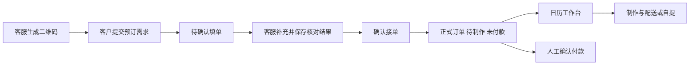

# macOS 本地启动与扫码接单演示

先启动数据库、后端和前端，再用普通浏览器窗口扮演客服、无痕窗口扮演客户，即可在一台 Mac 上走完业务。需要同一局域网的真手机扫码时，按第 6 节使用 dev HTTP 入口。

客户提交的填单需要客服核对并确认，才会成为正式订单。确认后的订单按**客户期望收货日期**出现在日历中，制作与付款分别管理。



## 1 准备环境

需要 Java 21 或以上、Node.js 22.18 或以上、Docker Desktop 和 OpenSSL；Node.js 24 与当前 CI 一致。先打开 Docker Desktop，等待引擎就绪。每个启动后端的新终端应先选择已安装的 JDK 21，避免终端环境优先使用 Java 17。

```sh
export JAVA_HOME="$(/usr/libexec/java_home -v 21)"
export PATH="$JAVA_HOME/bin:$PATH"
java -version
node --version
docker compose version
docker info
openssl version
```

以下使用你的仓库目录。每个新终端都需要先进入相应目录；已存在的开发配置、RSA 密钥和账号继续沿用，只执行尚未完成的首次配置步骤。

```sh
cd /Users/gorwaywong/Projects/GitHub/Wuhou
```

## 2 首次配置与后端启动

### 2.1 启动 PostgreSQL 和 Redis

在仓库根目录执行。条件判断会保留已经存在的 `dev.env`。

```sh
if [ ! -f docs/dev-ops/env/dev.env ]; then
  cp docs/dev-ops/env/dev.env.example docs/dev-ops/env/dev.env
fi

docker compose --env-file docs/dev-ops/env/dev.env \
  -f docs/dev-ops/compose/docker-compose-environment.yml \
  -f docs/dev-ops/compose/docker-compose-environment-dev.yml up -d --wait

set -a
source docs/dev-ops/env/dev.env
set +a
```

成功时 PostgreSQL 和 Redis 均为 healthy，开发端口默认是 `5432` 和 `6379`。`--env-file` 只给 Compose 提供配置；上面的 `source` 还会把后端 JVM 所需的连接配置加载到当前终端。

如果你调整了数据库或 Redis 的宿主机端口，需要同时修改 `dev.env` 中对应的 `SPRING_DATASOURCE_URL` 或 `SPRING_DATA_REDIS_PORT`。

### 2.2 构建后端

```sh
./mvnw -pl WuhouCake-bootstrap -am -DskipTests package
```

产物是 `WuhouCake-bootstrap/target/WuhouCake-bootstrap-0.1.0-SNAPSHOT.jar`。这是启动用的打包命令，跳过测试；正常启动时 Flyway 会自动执行迁移。

### 2.3 首次创建密钥和店长账号

**仅在还没有 RSA 密钥时执行生成命令。** 已有配对密钥就跳过生成，继续使用原文件。

```sh
umask 077
mkdir -p secrets/identity
chmod 700 secrets/identity
openssl genpkey -algorithm RSA -pkeyopt rsa_keygen_bits:2048 \
  -out secrets/identity/private.pem
openssl pkey -in secrets/identity/private.pem -pubout \
  -out secrets/identity/public.pem
chmod 600 secrets/identity/private.pem
```

在当前终端指定持久密钥路径：

```sh
export IDENTITY_PRIVATE_KEY="$PWD/secrets/identity/private.pem"
export IDENTITY_PUBLIC_KEY="$PWD/secrets/identity/public.pem"
```

如果数据库还没有超级管理员，使用编辑器创建初始化文件：

```sh
umask 077
nano secrets/identity/init-admin.json
```

填入下面的 JSON，将 `password` 替换为自己设置的 8–128 字符初始密码。nano 保存使用 `Control + O`、回车，再用 `Control + X` 退出。

```json
{"employeeNumber":"0001","nickname":"店长","password":"SET_YOUR_OWN_LONG_PASSPHRASE"}
```

```sh
chmod 600 secrets/identity/init-admin.json
java -jar WuhouCake-bootstrap/target/WuhouCake-bootstrap-0.1.0-SNAPSHOT.jar \
  --spring.profiles.active=dev \
  --wuhoucake.identity.command=init-admin \
  --wuhoucake.identity.credential-file="$PWD/secrets/identity/init-admin.json"
```

看到 `Administrator initialized` 表示成功，命令会自行退出。随后删除初始化文件：

```sh
rm secrets/identity/init-admin.json
```

已有管理员时直接使用原账号，重复初始化会返回 `ADMINISTRATOR_ALREADY_INITIALIZED`。忘记密码时使用[管理员恢复流程](admin-prod.md#3-忘记密码恢复)。

### 2.4 启动后端并保持运行

在已加载环境变量及密钥路径的终端中执行：

```sh
export CUSTOMER_ENTRY_PUBLIC_ORIGIN="${CUSTOMER_ENTRY_PUBLIC_ORIGIN:-auto}"
java -jar WuhouCake-bootstrap/target/WuhouCake-bootstrap-0.1.0-SNAPSHOT.jar \
  --spring.profiles.active=dev
```

后端默认监听 `8080`。另开终端检查数据库就绪状态：

```sh
curl -fsS http://127.0.0.1:8080/actuator/health/readiness
```

应返回含 `"status":"UP"` 的 JSON。开发接口文档位于 `http://127.0.0.1:8080/swagger-ui/index.html`。

## 3 启动前端和准备演示账号

另开一个终端执行，保持前端进程运行：

```sh
cd /Users/gorwaywong/Projects/GitHub/Wuhou/frontend
npm ci
npm run dev -- --port 5173 --strictPort
```

浏览器打开 `http://127.0.0.1:5173`。固定端口是为了让二维码地址与前端一致；如果 `5173` 已被占用，这个命令会明确报错。

首次用工号 `0001` 和你设置的初始密码登录，按提示修改密码，再重新登录。首次改密时，“当前密码”填写初始化时设置的密码。

店长可以在「员工管理」创建以下测试员工。保存后查看并记录本次生成的初始密码；员工第一次登录都需要改密。

| 工号示例 | 昵称示例 | 岗位 | 系统权限 | 演示用途 |
| --- | --- | --- | --- | --- |
| 0001 | 店长 | 店长 | 超级管理员 | 初始化已有，可直接完成全部员工侧演示 |
| 0002 | 演示客服 | 前厅店员 | 普通员工 | 生成二维码、核对填单、确认接单 |
| 0003 | 演示制作 | 裱花师 | 普通员工 | 可选，用于演示制作和协作 |

已有同工号账号时继续使用或换新工号。店长、前厅主管和前厅店员可处理客户填单；仅有裱花主管、裱花师或烘焙师岗位的账号看不到该入口。店长同时具有超级管理员身份。

首次可直接用店长账号跑通流程。要模拟客服身份，就退出店长账号后登录 `0002`；同时演示多个员工时使用不同浏览器或独立浏览器配置文件。

## 4 在一台 Mac 上模拟扫码录单

### 4.1 客服生成客户入口

在普通窗口登录店长或客服账号，依次操作：

1. 打开顶部「客户填单」。
2. 在「填单二维码」中点击「生成我的二维码」。
3. 看到二维码、客服姓名和「接收填单中」。
4. 右键「打开客户填写页面」，复制链接地址。

链接形如 `http://127.0.0.1:5173/#/fill/{token}`。二维码和这个链接指向同一个客户页面；本机演示直接打开链接即可。

### 4.2 客户提交预订需求

使用 `Command + Shift + N` 打开 Safari 或 Chrome 的无痕窗口，粘贴刚才的完整链接。该页面免登录。也可用 Chrome 开发者工具的设备模式查看手机布局。

建议用下面一份合成需求演示：

| 字段 | 演示填写 |
| --- | --- |
| 联系电话 | 13800000000，合成测试号码 |
| 收货方式 | 先选门店自提，减少地址填写；第二单再演示配送 |
| 期望收货时间 | 日历选择明天，下拉选择 18 时、00 分，按北京时间填写 |
| 商品类型及名称 | 蛋糕，芒果生日蛋糕 |
| 数量及尺寸 | 数量 1，尺寸 6；尺寸框只填数值 |
| 内胚及夹心 | 原味、芒果，可按演示需求更正 |
| 祝福语 | 生日快乐 |

点击「提交预订」。看到「已提交，待客服确认」和填单编号，表示提交成功。

**此时日历、经营统计和正式订单导出中还不会出现这份需求。** 客户侧不填写价格和业绩归属；提交后如需更正，联系发码客服处理。

## 5 客服确认和工作台管理

### 5.1 客服核对并接单

回到普通窗口的「客户填单」：

1. 查看范围选「我的二维码收到的」，处理状态选「待确认」，点击「刷新列表」。其他客服也可切到「全部客服的」处理。
2. 找到合成手机号对应的记录，点击「核对填单」。
3. 对照「客户原始填写」核对规格、数量、收货方式、期望收货时间及地址。
4. 在「接单信息」补齐整单约定金额，例如 `280` 元，以及业绩归属员工。到店自提时间（配送单显示「配送员取货时间」）选填，可接单后再安排。
5. 先点「保存核对结果」，成功后再点「确认接单」。修改了输入后需要重新保存，确认按钮才会恢复可用。
6. 看到「已确认并生成正式订单」，点击「查看正式订单」。

整单金额是与客户约定的价格，不会按商品报价自动求和。发码客服、实际确认员工和业绩归属员工可以不同；演示时应主动选择归属，不能把二维码所属员工当作自动归属。

同一联系电话、同一收货日期有其他填单或正式订单时，先核对全部疑似重复记录；确为独立订单时勾选「已核实，这是独立订单，继续接单。」。取消订单仅作历史参考；记录变化后须重新核对。

### 5.2 在日历找到正式订单

打开顶部「日历工作台」，选择刚才填写的**收货日期**，清除状态和付款筛选。演示填写的是明天，就切到明天，而不是只看今天。

确认后的订单初始为「待制作」「未付款」。点击订单进入详情，可查看客户资料、商品、约定金额，以及「来源：用户填写」的原始填单和处理记录。

客户期望收货时间与内部交接时间分别保存。例如客户希望 18:00 收到、门店 17:30 交出，日历按客户收货日期归日，订单交接时刻显示 17:30。

### 5.3 推进制作和交付

在订单详情按实际动作操作：

| 场景 | 操作顺序 |
| --- | --- |
| 自提 | 开始制作 → 可选确认整单夹层、确认整单抹面 → 整单制作完成 → 待自提 → 确认自提 → 已完成 |
| 配送 | 开始制作 → 可选确认制作节点 → 整单制作完成 → 待配送 → 开始配送 → 配送中 → 完成配送 → 已完成 |

制作按整单推进。夹层和抹面可以跳过，跳过会显示未记录；制作完成后仍须手动确认配送完成或客户自提。

付款独立操作：实际收款后点「确认已付款」。完成制作、完成交付都不会自动标记付款；误标可使用「改为未付款」更正。

其他管理操作：

- 「编辑资料」更正联系信息、金额和时间；更正收货日期时需要同时填写完整时刻。待交接阶段要改商品，先执行「重新制作」。
- 备注对象可选整单或某件商品；参考图片支持 JPG/PNG。备注结果不明时先核对记录，再决定是否允许重发。
- 取消订单需填写原因。商品至少保留一件，移除商品不会自动重算整单约定金额。
- 「订单查询与统计」可按录单日期或收货日期、状态、付款和员工查询；订单号可进入详情，也可导出经营 XLSX。核对日期口径和范围，确保包含演示订单。

## 6 可选 用真手机扫描 Mac 上的二维码

手机与 Mac 连接同一局域网。`dev` 支持 HTTP；`prod` 仍必须使用 HTTPS，同时启用两个 profile 时按 `prod` 执行。

### 6.1 使用 Mac 的局域网地址启动后端

开发环境默认使用 `auto`，启动时从系统 Wi-Fi 网卡读取局域网 IPv4，生成 `http://Wi-Fi地址:5173`。macOS 通过硬件端口识别 Wi-Fi 网卡，不假定它一定是 en0；不选择 VPN 或虚拟网卡。未发现可用 Wi-Fi 地址时回退到 `http://127.0.0.1:5173` 并记录告警，此时仅本机可访问。

```sh
ipconfig getifaddr en0
```

在仓库根目录的后端终端中，沿用第 2 节的数据库配置与 RSA 路径，以自动模式启动：

```sh
export CUSTOMER_ENTRY_PUBLIC_ORIGIN=auto
java -jar WuhouCake-bootstrap/target/WuhouCake-bootstrap-0.1.0-SNAPSHOT.jar \
  --spring.profiles.active=dev
```

### 6.2 前端监听局域网并扫码

在 `frontend` 目录启动前端：

```sh
npm run dev -- --host 0.0.0.0 --port 5173 --strictPort
```

1. Mac 打开 `http://Mac局域网IP:5173`，员工登录后进入「客户填单」，生成二维码或刷新页面中的既有二维码。
2. 手机先确认能打开同一个地址，再扫码进入客户填写页并提交。
3. 客服点击「刷新列表」，按第 5 节保存核对结果、确认接单并管理正式订单。

IP 改变时，重启后端并刷新二维码页面即可，无需修改配置或重置二维码。启动日志会输出自动选择的源站；显式设置 `CUSTOMER_ENTRY_PUBLIC_ORIGIN=http://实际IP:端口` 可用于有线网络或非 5173 端口。生产环境不执行自动探测，继续使用配置的 HTTPS 服务器 IP 或域名源站。macOS 防火墙需允许前端 Node 进程接收连接，Wi-Fi 不能开启阻断设备互访的客户端隔离。手机的 `/api` 请求经前端代理到后端，不需要把数据库端口暴露给手机。

## 7 日常重启和常见卡点

首次配置完成后，每次只需：启动 Docker Desktop 和 Compose 依赖；在后端终端加载 `dev.env`、导出原 RSA 路径并保持公开源站为 auto、启动 JAR；在另一个终端启动 Vite。源码变更后才需要重新打包，锁文件变更或依赖缺失时再执行 `npm ci`。

停止前后端分别按 `Control + C`。需要停止数据库容器时执行下面命令，保留数据卷：

```sh
cd /Users/gorwaywong/Projects/GitHub/Wuhou
docker compose --env-file docs/dev-ops/env/dev.env \
  -f docs/dev-ops/compose/docker-compose-environment.yml \
  -f docs/dev-ops/compose/docker-compose-environment-dev.yml stop
```

| 现象 | 优先检查 |
| --- | --- |
| `UnsupportedClassVersionError`，提示 65.0 与 61.0 | 当前调用的是 Java 17；执行 `export JAVA_HOME="$(/usr/libexec/java_home -v 21)"`，再用 `"$JAVA_HOME/bin/java" -jar ...` 启动已有 JAR |
| 后端连接 PostgreSQL/Redis 失败 | Docker 是否就绪；容器是否 healthy；当前后端终端是否加载 `dev.env`；修改端口后 JVM 配置是否同步 |
| 后端提示密钥缺失或权限不合法 | 两个 RSA 路径是否为原文件的绝对路径；私钥和初始化 JSON 是否为普通文件且权限 `600` |
| 初次登录后不能进入业务 | 先使用初始密码完成改密，再重新登录 |
| 看不到「客户填单」 | 当前员工是否具有前台或管理人员岗位 |
| 客户提交后列表没有出现 | 点击「刷新列表」，核对查看范围、处理状态及二维码所属员工 |
| 「确认接单」不可点击 | 金额、业绩归属是否完整；是否已保存核对结果；是否已核实最新的疑似重复记录或并发更新 |
| 确认后日历没有订单 | 是否选到了客户收货日期；是否仍有状态或付款筛选 |
| 手机打不开 `127.0.0.1` 或 `localhost` | 手机会把它们解释为手机自身；使用第 6 节的 Mac 局域网 HTTP 地址 |
| 手机打不开 Mac 局域网地址 | 检查前端是否用 `--host 0.0.0.0` 启动、Mac 防火墙是否允许 Node 接收连接、Wi-Fi 是否允许设备互访 |
| 反复提交返回 429 | 默认同来源每分钟 10 次、每小时 100 次；本地代理演示可能共用来源计数，等待窗口恢复 |

相关契约：[账号与初始化](../identity.md)、[客户扫码填单](../customer-entry.md)、[订单业务与 API](../../WuhouCake-order/README.md)、[部署说明](README.md)。
