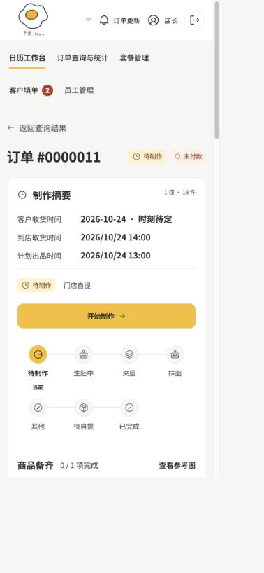
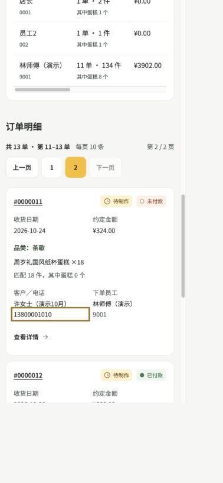
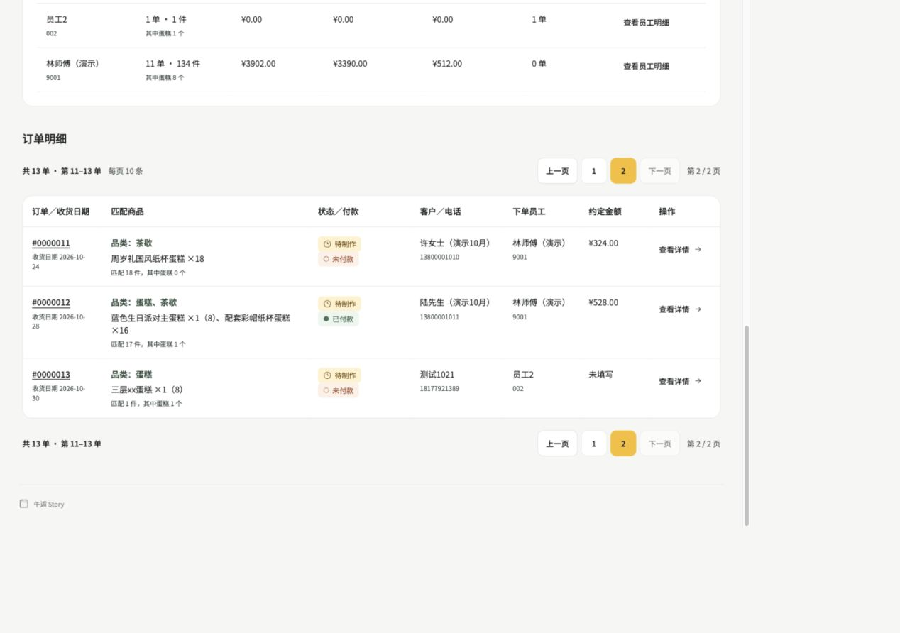
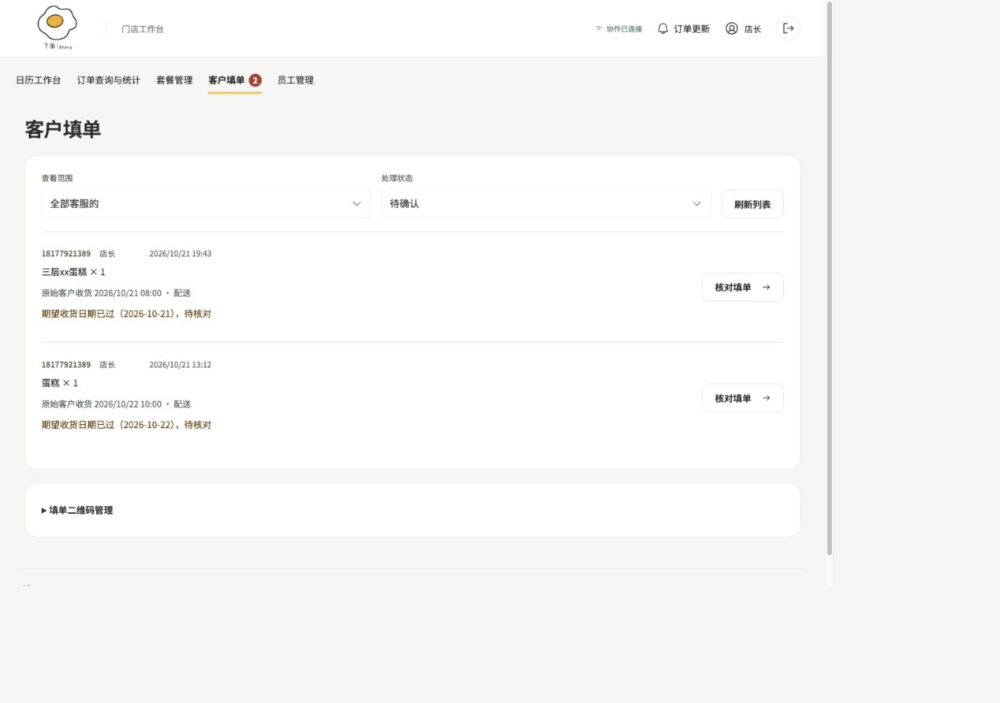

# F1–F4 轻量验证

2026-10-28，基于 `1c11e42` 的本地修改。仅修改文档与前端，无后端接口、数据库、制作或删除规则变更。

- 三份业务文档统一必经制作节点、日期边界及套餐模板说明。
- 订单详情的当前操作置于完整进度之前，导出置于制作摘要之后。
- 手机订单明细使用卡片，桌面保留表格；两类汇总表增加手机滑动提示。
- 待确认填单按北京时间日期显示过期提醒，已保存核对日期优先。

## 自动检查

在 frontend 执行 `node --experimental-strip-types --test tests/customerSubmission.test.ts tests/management.test.ts tests/productionView.test.ts`：15 项通过。新增用例覆盖日期边界、核对日期优先、北京时间跨日及非待确认状态。

`npm run build` 通过；保留 Vite 大于 500 kB 的 bundle 提示，本次不扩展性能优化范围。`git diff --check` 通过。

## 浏览器抽查

使用既有 dev 店长会话，重启 Vite 确保最新资源生效。没有新增订单、提交客户填单或推进业务状态。

- 390px CSS 宽度：操作块位于进度条之前，页面无横向溢出；手机卡片可见金额和详情入口，两处滑动提示可见。
- 1280px CSS 宽度：卡片隐藏，桌面表格显示正常。
- 经营查询第二页 → #0000011 → 返回查询，仍保留日期范围和第二页。
- 两条既有过期填单显示对应日期提醒。正常日期及非待确认状态由定向测试覆盖，未制造新业务记录。
- 未重跑后端、全量端到端或容量测试；已删除模式复用同一卡片数据分支，本轮未另造删除数据。

